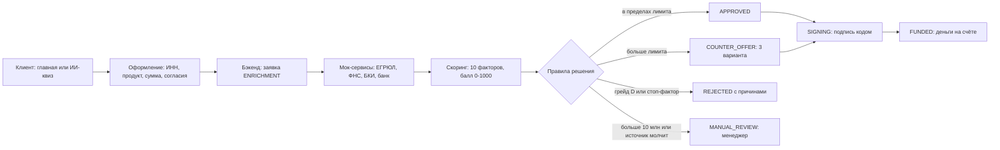

# Vibe Security: материалы к «Умному кредитному кабинету»

Рабочие материалы команды Vibe Security для Альфа-Будущее Хакатона 2026, трек «Умный кредитный кабинет предпринимателя». Дедлайн 26.10 вечером.

Здесь лежит всё, что нужно для работы: документы, мок-сервисы, модель скоринга, макеты экранов и данные команды. Сам продукт пишется в репозитории Димы [zdmitryi/alfabank-hack](https://github.com/zdmitryi/alfabank-hack). Отсюда туда переносим только код из папки `Код/`.

Версия материалов: 22.10.2026.

## С чего начать

| Кто | Что открыть первым |
|---|---|
| Все | Этот README, потом `Документы/Vibe Security - бриф v5.pdf` |
| Дмитрий | `Документы/Vibe Security - инструкции команде.docx`, раздел 5; папки `Код/mocks` и `Код/scoring` |
| Владимир | Инструкции, раздел 6 с таблицей из 13 правок к макетам; папка `Экраны фронта` |
| Елизавета и Марина | Инструкции, раздел 7; файл `Код/scoring/scoring.py` |
| Антон | `Документы/Vibe Security - ТЗ мок-сервисы.docx` и `Код/mocks` |

## Как всё работает



1. Клиент подбирает кредит на главной или проходит ИИ-квиз из четырёх вопросов.
2. Вводит ИНН. Бэкенд спрашивает мок ЕГРЮЛ, и карточка компании заполняется сама.
3. Клиент выбирает продукт, сумму и срок, видит цену с опцией и без, даёт два отдельных согласия и отправляет заявку.
4. Бэкенд собирает данные из моков ЕГРЮЛ, ФНС, БКИ и банка. Если источник не ответил за 3 секунды, заявка уходит менеджеру, а не падает.
5. Скоринг считает балл от 0 до 1000 по десяти факторам. Скоринг только оценивает риск.
6. Решение принимают правила: стоп-факторы, лимит по грейду, контрпредложения, ручное рассмотрение.
7. Клиент видит решение и объяснение: какие факторы повлияли и что сделать, чтобы лимит вырос.
8. Клиент принимает вариант, подписывает кодом (в демо 1234) и получает деньги.

Менеджер видит очередь заявок на ручном решении, вклад факторов в балл, ИИ-резюме и может одобрить, сделать контрпредложение, запросить документы или отказать.

## Что лежит в репозитории

| Путь | Что это | Что поменялось 22.10 |
|---|---|---|
| `Документы/Vibe Security - бриф v5.pdf` | Главный документ: рынок, гипотезы H1–H6, статусы, таблица переходов, скоринг, тестовые компании, план | Новая версия вместо v4: статусы по схеме команды, скоринг команды 0–1000, семь тестовых ИНН, план с 22.10 |
| `Документы/Vibe Security - инструкции команде.docx` | Что и как делает каждый: бэкенд, фронт, ML, моки | Переписаны разделы про статусы, скоринг и экраны; добавлены 13 правок к макетам и раздел про моки |
| `Документы/Vibe Security - ТЗ мок-сервисы.docx` | Задание на мок-сервисы: контракты, данные компаний, сбои | Новый документ |
| `Документы/Vibe Security - исследование v3.pdf` | Исследование рынка с источниками: боли клиентов, конкуренты, зарубежный опыт, обоснование гипотез | Раздел о скоринге описывает модель команды и её слабые места; статусы по схеме команды |
| `Документы/исходники/` | Те же инструкции, ТЗ и исследование в Markdown, чтобы читать прямо на GitHub | Новое |
| `Код/mocks/` | Готовые мок-сервисы на WireMock для семи ИНН | Новое, подробности в `Код/mocks/README.md` |
| `Код/mocks.zip` | Та же папка одним архивом | Новое |
| `Код/scoring/scoring.py` | Исправленная модель скоринга команды на Python с правилами решения | Исправлена формула балла, подробности в `Код/README.md` |
| `Код/scoring/TeamScoring.kt` | Та же модель на Kotlin для бэкенда | Новое |
| `Экраны фронта/` | Шесть HTML-макетов Владимира в стиле Альфы | Без изменений, правки описаны в `Экраны фронта/README.md` |
| `Данные команды/` | Схема пути, схема состояний, скоринг команды, сид-данные | Без изменений, замечания в `Данные команды/README.md` |

## Что поменялось по сравнению с прошлой версией (21.10)

- **Статусы заявки** теперь по схеме команды: `DRAFT → ENRICHMENT → SCORING → DECISION → APPROVED / COUNTER_OFFER / REJECTED → SIGNING → FUNDED`. Добавлены `MANUAL_REVIEW`, `NEEDS_MORE_INFO` и `CLOSED`: без них не работают экран менеджера, дозапрос документов и срок действия предложений.
- **Скоринг** заменён на модель команды: 10 факторов, балл 0–1000, грейды A–D. Старая карта с PDO и стартом 530/560 больше не используется.
- **Формула балла** исправлена на `600 + 2 × сумма баллов факторов`. С формулой `500 + сумма` из кода команды максимум 630, грейд A недостижим, а Хлебный двор получает грейд D и отказ вместо контрпредложений.
- **Тестовые компании**: три профиля из сид-данных команды плюс четыре ИНН для сбоев. Все ИНН синтетические, с правильными контрольными суммами.
- **Мок-сервисы** делает Антон, они уже готовы в `Код/mocks`.
- **Макеты** берём у Владимира вместо старых макетов из брифа.

## Что осталось как было

- Шесть гипотез H1–H6 и их приоритеты.
- Стек: бэкенд на Kotlin и Spring Boot, фронт на Next.js, локальная модель через Ollama, всё поднимается одной командой.
- Ставка на надёжность: идемпотентность, журнал событий, деградация вместо падения при сбое источника.
- Два отдельных согласия (БКИ и персональные данные) и вход по коду.
- Ленту новостей не делаем, рост одобрений не обещаем.

Старые версии (бриф v4, исследование v2, наши макеты экранов, PDF плана) удалены: их заменили файлы выше.

## Тестовые ИНН

| ИНН | Компания | Итог |
|---|---|---|
| 7704983159 | ООО «ТехноПрогресс» | 800 баллов, грейд A, одобрение |
| 7703168426 | ООО «Хлебный двор» | 580 баллов, грейд C, три контрпредложения |
| 7729501760 | ООО «СтройМаркет» | 200 баллов, грейд D, отказ с объяснением |
| 7722085341 | ООО «Северный ветер» | БКИ молчит 10 секунд, заявка уходит менеджеру |
| 7731497609 | ООО «Лесная поляна» | ФНС дважды падает, потом отвечает |
| 7736150978 | ООО «Старый склад» | ликвидирована, отказ без скоринга |
| любой другой | — | не найден, клиент вводит данные вручную |

## Как запустить моки

```bash
cd Код/mocks
docker run --rm -p 8089:8080 -v "$PWD:/home/wiremock" wiremock/wiremock:3.9.1
curl http://localhost:8089/egrul/v1/companies/7703168426
```

В репозитории продукта моки поднимаются вместе со всем остальным через `docker compose`, кусок конфигурации лежит в `Код/mocks/docker-compose.mocks.yaml`.

## Что нужно решить

1. Елизавета и Марина подтверждают формулу `600 + 2 × сумма` или предлагают свою, при которой достижимы все грейды.
2. Дмитрий принимает статусы по схеме команды с тремя добавленными.
3. Марина меняет ИНН в сид-данных: два из них принадлежат реальным банкам.
4. Владимир берёт 13 правок к макетам.
5. Кто поднимает бесплатный сервер для демо.

## Важно

- Моки и скоринг ещё не запускались: нужны Docker и Java 11+ для WireMock, Python или Kotlin для скоринга. Числа в файлах пересчитаны вручную.
- Это приватный репозиторий для команды. Для сдачи на хакатон используется репозиторий продукта.
